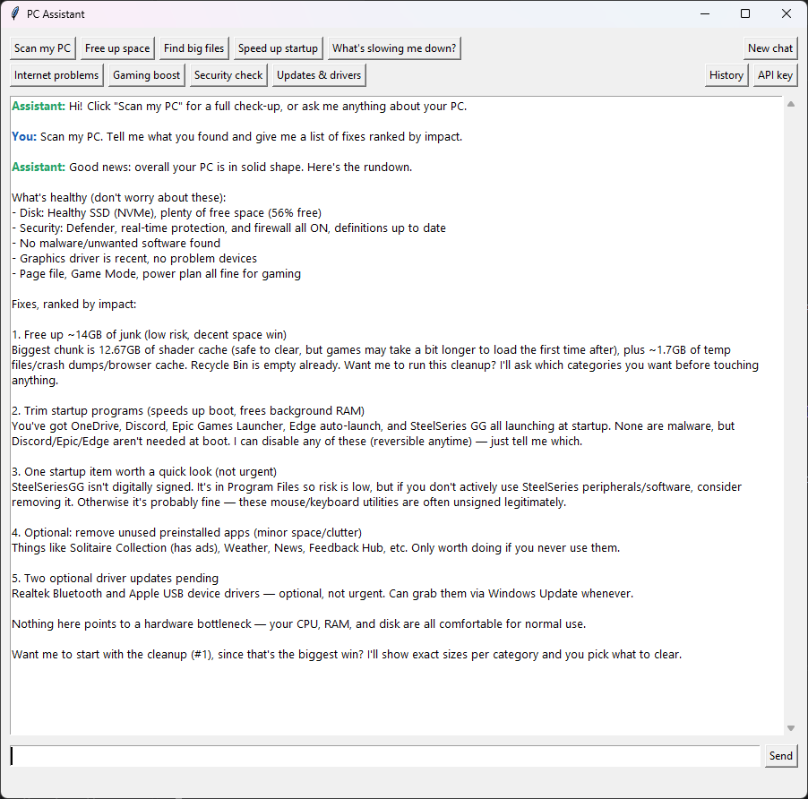

# PC Assistant

[](https://github.com/jakedarlington24-cyber/pc-optimizer/actions/workflows/tests.yml)

**An AI-powered Windows tune-up tool that behaves like an honest technician: it diagnoses first, explains what it finds in plain English, and only changes things one at a time, with your permission, and with an undo button.**



Most "PC optimizer" apps run a one-click "fix everything" routine, and many are outright scareware. PC Assistant takes the opposite approach. It uses Claude (Anthropic's AI model) with a set of carefully scoped tools to look at real data from your PC, figure out *why* it's slow, rank fixes by impact, and tell you when the real answer is "nothing's wrong" or "you need an SSD."

## What it can do

| Area | Checks (read-only) | Fixes (always asks first) |
|---|---|---|
| **Full scan** | One click runs 13 checks in about 10 seconds and produces a ranked report | |
| **Performance** | CPU/RAM/disk usage, heaviest programs (grouped by app), CPU throttling, uptime, pending restarts | Close a program, switch power plan |
| **Disk** | Free space on every drive, disk health (SSD vs HDD, SMART status) | |
| **Storage** | Reclaimable space by category, largest files, duplicate files (compared by content), installed programs by size | Clean temp files, browser caches, shader caches, crash dumps, Windows Update leftovers, Recycle Bin |
| **Startup** | Startup programs, with digital-signature checks | Disable a startup program |
| **Security** | Defender/firewall status, known adware and scareware, unsigned or suspicious startup entries, programs running from Temp, browser extensions | Remove preinstalled bloat apps |
| **Updates & drivers** | Pending Windows updates, graphics driver age, devices with errors | Opens the *official* NVIDIA/AMD/Intel download page |
| **Network** | Ping and packet loss to router and internet, Wi-Fi signal, DNS | Flush DNS, reset network stack |
| **Gaming** | Game Mode, background recording, GPU scheduling, visual effects, page file | Toggle Game Mode and Game Bar recording |
| **Repair** | | Run DISM + `sfc /scannow` |

## Safety design

Letting an AI change settings on someone's PC is only OK if it's built to be trustworthy. These are the rules the app follows:

- **Read-only by default.** 25 of the 36 tools only *look*. The 11 tools that change something are listed in one place in code (`ACTIONS_REQUIRING_CONFIRMATION`) and always show a plain-English confirmation popup first.
- **Undo history.** Every change is logged. Settings changes (startup programs, power plan, game settings) save their previous state and can be undone with one click from the History window.
- **Least privilege.** The app runs as a normal user. The few actions that need admin rights open a separate Windows (UAC) prompt, so the user sees exactly when elevation happens.
- **Deletes only from fixed, known-safe folders.** Cleanup can never touch arbitrary paths. Large and duplicate files are only *reported*, and the user decides what to delete.
- **No snake oil.** The model is instructed never to recommend registry cleaners, "RAM boosters", driver-updater programs, or disabling Windows services, and to send users to manufacturers for drivers.
- **Honest about limits.** If a sensor isn't available (for example, many motherboards don't report CPU temperature to Windows), the tool says so instead of guessing, and flagged items are described as "worth checking", not "malware".

## How it works

```
 You ──► Tkinter GUI ──► Claude (tool use) ──► pc_tools.py ──► Windows
           ▲                    │                  │  (psutil, registry, PowerShell/CIM,
           │   confirmation ◄───┘                  │   powercfg, Windows Update API)
           └──────── plain-English answer ◄────────┘
```

1. The user asks a question or clicks a button such as **Scan my PC**.
2. Claude decides which tools to call. Read-only tools run immediately.
3. If Claude wants to change something, the app shows a confirmation popup. Nothing happens unless the user clicks **Yes**.
4. Tool results go back to Claude, which explains them and suggests next steps.

| File | Purpose |
|---|---|
| `ask_claude_gui.py` | The desktop app: chat window, quick-action buttons, confirmation popups, API key setup, History window |
| `ask_claude.py` | The same assistant in a terminal, handy for testing |
| `pc_tools/catalog.py` | The tools Claude can call (JSON schemas), the list of actions needing confirmation, and confirmation text |
| `pc_tools/diagnostics.py`, `storage.py`, `security.py`, `updates.py`, `network.py`, `settings.py` | The tools themselves, grouped by area |
| `pc_tools/scan.py` | The one-click full scan, which runs every check in parallel |
| `pc_tools/history.py` | Change log and undo. Each module registers an undo handler for its own kind of change |
| `pc_tools/prompt.py` | Model settings and the system prompt that sets the assistant's rules |
| `pc_tools/common.py`, `api_key.py` | Shared helpers, and API key storage |

## Getting started

**Requirements:** Windows 10 or 11, Python 3.10+, and an [Anthropic API key](https://console.anthropic.com/settings/keys). You pay Anthropic per use; a typical scan-and-explain conversation costs a few cents.

1. Download this repository (the green **Code** button → **Download ZIP**, or `git clone`), and open a terminal in its folder.
2. Install the dependencies and start the app:

```powershell
python -m pip install -r requirements.txt
python ask_claude_gui.py
```

On first launch the app asks for your API key, checks that it works, and saves it for your Windows user account only.

## Tests

```powershell
python -m pip install -r requirements-dev.txt
python -m pytest
```

The test suite runs on every push via GitHub Actions (Windows, Python 3.10 and 3.14). It needs no API key and never changes the real PC:

- **Safety rules:** every tool Claude can call is wired up correctly, every action that changes something has a confirmation message, and cleanup can only ever target known-safe folders.
- **Tool-use loop:** a fake Claude client checks that declined actions never run, approved ones do, and restore points are made when needed.
- **Undo history:** startup entries, game settings and power plans are restored exactly, using throwaway registry keys and a stubbed `powercfg`.
- **File tools:** deletion skips files in use, and duplicate detection compares content rather than names. These run in temporary folders.

## Ideas for the future

- Prompt caching to cut API costs
- A packaged `.exe` so non-developers can try it without installing Python
- Exportable scan reports to share with a technician

## License

MIT, see [LICENSE](LICENSE).
